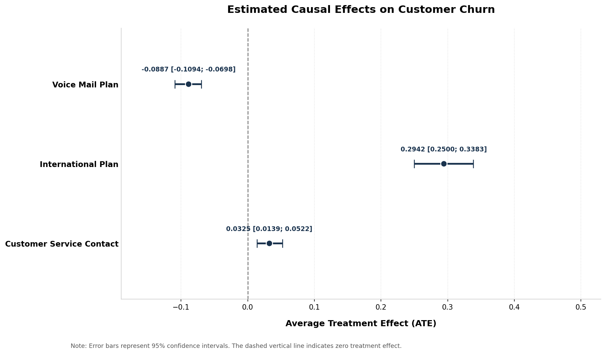
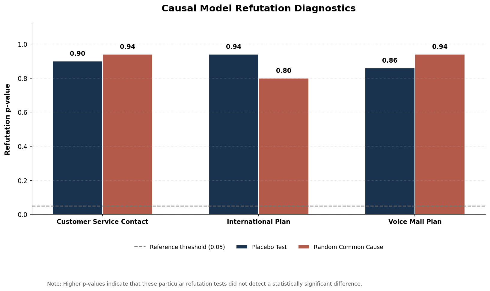
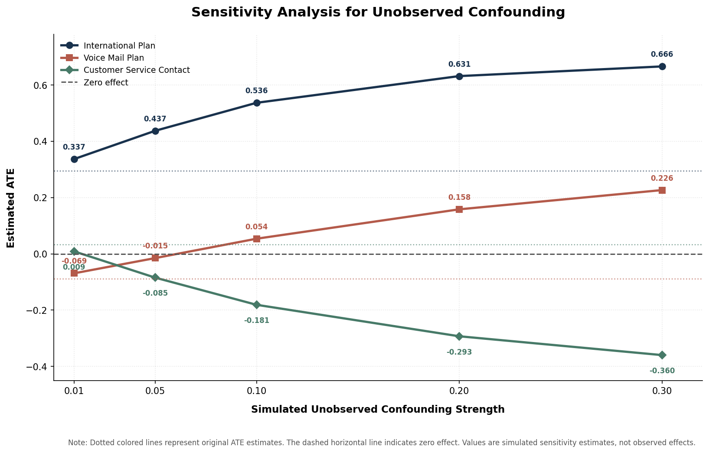

# Causal Analysis of Customer Churn

## Project Overview

Customer churn is commonly studied as a prediction problem: identifying customers who are likely to leave.

This project takes a complementary approach by examining how selected subscription and customer-service variables relate to churn under an explicit causal framework.

Using observational customer data and the DoWhy framework, the analysis defines causal assumptions, estimates Average Treatment Effects (ATE), performs refutation checks, and explores sensitivity to potential unobserved confounding.

The objective is to translate model-based findings into practical business questions while being transparent about the assumptions and limitations of observational causal analysis.

## Business Questions

The analysis investigates three questions:

1. How does having an International Plan relate to customer churn?
2. How does having a Voice Mail Plan relate to customer churn?
3. How does having contacted customer service at least once relate to customer churn?

The outcome variable is `churn`, encoded as 1 for churn and 0 otherwise.

## Dataset

The analysis uses the Customer Churn dataset distributed through the Tidymodels `modeldata` ecosystem.

- **Observations:** 5,000
- **Original variables:** 20
- **Observed churn rate:** 14.14%
- **Derived analysis variable:** `customer_service_contact`

The original dataset is not included in this repository.

Dataset sources:

- [Tidymodels MLC Churn dataset](https://modeldata.tidymodels.org/reference/mlc_churn.html)
- [CRAN modeldata package](https://cran.r-project.org/web/packages/modeldata/index.html)

Please consult the original source for dataset terms and licensing before reuse.

## Analytical Approach

### 1. Data Preparation

The workflow includes:

- Loading and validating required variables
- Checking missing values
- Encoding binary treatment and outcome variables
- Creating `customer_service_contact`, defined as 1 when a customer has made at least one customer-service call and 0 otherwise

No missing values were found in the variables used in the reported analysis.

### 2. Causal Framework and DAG

A separate Directed Acyclic Graph (DAG) is specified for each treatment.

The assumed structure is:

- Adjustment variables → Treatment
- Adjustment variables → Churn
- Treatment → Churn

The predefined adjustment set contains six variables:

- `total_day_minutes`
- `total_day_calls`
- `total_eve_minutes`
- `total_eve_calls`
- `total_night_minutes`
- `total_night_calls`

These variables are treated as adjustment variables under the working causal assumptions.

The dataset does not establish the temporal ordering of all variables. Therefore, the DAG and adjustment set represent explicit modeling assumptions that require domain justification; they are not facts established by the observed data.

### 3. Effect Estimation

The Average Treatment Effect (ATE) is estimated using a generalized linear model with a binomial family.

The effect is expressed as a risk difference:

`ATE = E[Y | do(T=1)] - E[Y | do(T=0)]`

Results are reported with 95% confidence intervals and expressed in percentage points (pp) for business interpretation.

These estimates are conditional on the specified DAG, adjustment set, and statistical model.

### 4. Refutation Checks

Two refutation methods are applied:

- Placebo treatment
- Random common cause

These checks examine whether the estimates are sensitive to specific diagnostic changes. They do not prove that the DAG is correct, establish causal validity, or eliminate all potential sources of bias.

### 5. Sensitivity Analysis

The analysis introduces simulated unobserved common causes at different effect-strength settings using DoWhy's `add_unobserved_common_cause` refutation method.

The purpose is to explore how estimated effects respond under simulated confounding scenarios.

The strength settings are implementation-specific simulation parameters. They should not be interpreted as real-world probabilities, confounder prevalence, or direct measurements of actual confounding.

## Key Results

The estimated ATEs and 95% confidence intervals are:

| Treatment | ATE | 95% Confidence Interval |
|---|---:|---:|
| International Plan | +29.42 pp | +25.00 to +33.83 pp |
| Voice Mail Plan | -8.87 pp | -10.94 to -6.98 pp |
| Customer Service Contact | +3.25 pp | +1.39 to +5.22 pp |

All three reported confidence intervals exclude zero under the specified estimation procedure.

### International Plan

The estimated ATE is **+29.42 percentage points**.

Under the specified model and causal assumptions, having an International Plan corresponds to a higher estimated churn risk.

This is the largest estimated effect among the three treatments and represents a priority for further business investigation.

Potential areas to investigate include plan pricing, usage patterns, plan communication, and customer experience.

### Voice Mail Plan

The estimated ATE is **-8.87 percentage points**.

Under the specified model and assumptions, having a Voice Mail Plan corresponds to a lower estimated churn risk.

This finding motivates further investigation into feature awareness, usage, and customer engagement. The analysis does not establish the mechanism behind this relationship.

### Customer Service Contact

The estimated ATE is **+3.25 percentage points**.

Customers who contacted customer service at least once have a higher estimated churn risk under the specified model.

This variable may serve as an operational signal for identifying customers whose issues deserve further attention. The result should not be interpreted as evidence that contacting customer service itself causes churn.

## Refutation Results

The reported refutation p-values are:

| Treatment | Placebo p-value | Random Common Cause p-value |
|---|---:|---:|
| International Plan | 0.90 | 0.80 |
| Voice Mail Plan | 0.86 | 0.94 |
| Customer Service Contact | 0.90 | 0.94 |

These tests did not detect a statistically significant difference under the particular refutation procedures and simulation settings used.

High p-values do not prove that the original estimates are unbiased or that the causal assumptions are correct.

## Sensitivity Analysis Findings

The sensitivity analysis explores five simulated effect-strength settings: 0.01, 0.05, 0.10, 0.20, and 0.30.

Under the implemented simulation:

- The International Plan estimate remained positive across all tested settings.
- The Voice Mail Plan estimate changed sign at the 0.10 setting.
- The Customer Service Contact estimate changed sign at the 0.05 setting.

These results indicate that the estimates respond differently to the simulated unobserved-confounding scenarios.

The sign changes are properties of the specified simulations. They do not establish that real-world confounding would produce the same changes or that the underlying causal effects actually reverse.

## Business Implications

The findings suggest three areas for further investigation:

1. **International Plan:** Review pricing, usage patterns, plan communication, and customer experience among subscribers.
2. **Voice Mail Plan:** Investigate whether feature awareness, usage, and onboarding are related to customer engagement and retention.
3. **Customer Service Contact:** Review reasons for support contact, first-contact resolution, and opportunities for proactive follow-up.

These are investigation priorities, not proven intervention effects. Business decisions should consider operational context and additional evidence.

## Proposed Business Validation

The observational findings can inform future controlled experiments:

- **International Plan:** Test alternative plan communication or service improvements among eligible customers.
- **Voice Mail Plan:** Test a feature-awareness or onboarding intervention against standard communication.
- **Customer Service Contact:** Compare proactive follow-up after support interactions with the existing process.

Each experiment should define eligibility criteria, random assignment, the churn measurement window, and business guardrails such as revenue, customer satisfaction, and support costs.

These experiments are proposed future work and have not been conducted in this project.

## Visual Results

### Average Treatment Effects



### Refutation Diagnostics



### Unobserved Confounding Sensitivity



## Limitations

- The analysis uses observational data and relies on assumptions encoded in the DAG.
- The dataset does not provide sufficient temporal detail to verify the ordering of all variables.
- Unobserved confounding cannot be ruled out.
- The adjustment set may not capture every relevant factor.
- The customer-service call count is simplified into a binary indicator of at least one contact.
- ATE describes an average estimated effect, not the response of every individual customer.
- Refutation and sensitivity checks do not establish causal validity.
- The sensitivity analysis uses simulated confounding settings rather than measured real-world confounders.

The results should therefore be interpreted as model-based estimates under explicit assumptions, not guaranteed outcomes of business interventions.

## Reproducibility

Install the project dependencies:

```bash
pip install -r requirements.txt
```

Obtain the dataset from its public source and place the CSV file at:

```text
data/churn.csv
```

Before running the analysis, ensure that the `DATA_PATH` and `OUTPUT_DIR` variables in `src/causal_analysis.py` point to the dataset and output directories on your machine.

Run the analysis:

```bash
python src/causal_analysis.py
```

The generated analysis outputs are saved to the configured output directory.

The original dataset is excluded from version control and is not included in this repository.

## Tools

- Python
- Pandas
- NumPy
- Statsmodels
- DoWhy
- Matplotlib
- Git and GitHub

## Project Scope

This portfolio project focuses on:

**Data Preparation → DAG → Adjustment → ATE Estimation → Refutation → Sensitivity Analysis → Business Interpretation**

The emphasis is on transparent causal assumptions, reproducible analytical workflows, diagnostic checks, and business-oriented communication.
